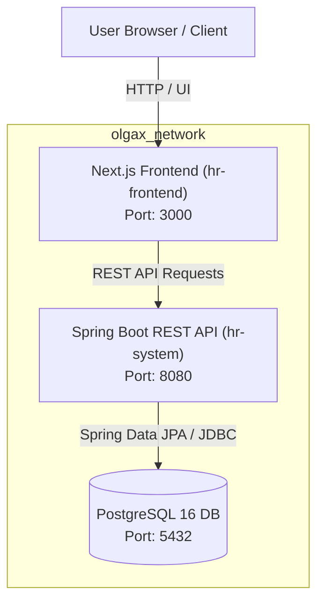

# 🏢 OLGAX HR Management System

[](https://spring.io/projects/spring-boot)
[](https://nextjs.org/)
[](https://react.dev/)
[](https://openjdk.org/)
[](https://www.postgresql.org/)
[](https://www.docker.com/)
[](https://tailwindcss.com/)

A modern, full-stack enterprise Human Resource and Payroll Management System. **OLGAX HR** streamlines employee onboarding, organizational hierarchy, flexible salary structures, and automated payroll execution through a secure Java Spring Boot backend and an intuitive Next.js web application.

---

## 📑 Table of Contents

- [Overview & Key Features](#-key-features)
- [System Architecture](#-system-architecture)
- [Tech Stack](#-tech-stack)
- [Repository Structure](#-repository-structure)
- [Quick Start with Docker Compose](#-quick-start-with-docker-compose-recommended)
- [Manual / Local Development Setup](#-manual--local-development-setup)
  - [Prerequisites](#prerequisites)
  - [1. Database Setup](#1-database-setup)
  - [2. Backend Setup (`hr-system`)](#2-backend-setup-hr-system)
  - [3. Frontend Setup (`hr-frontend`)](#3-frontend-setup-hr-frontend)
- [Configuration & Environment Variables](#-configuration--environment-variables)
- [REST API Reference](#-rest-api-reference)
  - [Employee Endpoints](#employee-endpoints)
  - [Departments & Positions](#departments--positions)
  - [Salary Structures & Deductions](#salary-structures--deductions)
  - [Payroll Runs & Payslips](#payroll-runs--payslips)
- [Running Automated Tests](#-running-automated-tests)
- [Troubleshooting & FAQs](#-troubleshooting--faqs)
- [License](#-license)

---

## ✨ Key Features

- **👥 Employee Directory & Lifecycle Management**:
  - Full CRUD capabilities: create, update, search, filter, and remove employee records.
  - Comprehensive profile viewer modal with department and position association.
- **🏢 Organizational Structure**:
  - Department and position directory tracking for workforce organization.
- **💰 Dynamic Salary Structure & Deductions**:
  - Configurable base salaries, allowances, and bonuses.
  - Flexible deduction rules supporting both **fixed** amounts and **percentage-based** calculations (e.g., Pension/EPF, Taxes, Insurance).
  - Effective date tracking and active/historical salary structure management.
- **⚡ Automated Payroll Engine**:
  - Period-based payroll run triggers (`startDate`, `endDate`, `paymentDate`).
  - Automated calculation of gross pay, itemized deductions, and net salary.
  - Lifecycle state tracking (`DRAFT`, `PROCESSING`, `COMPLETED`, `FAILED`).
  - Detailed payslip generation accessible per employee or payroll run.
- **📊 Interactive Frontend Dashboards**:
  - Responsive web interface built with **Next.js 16**, **React 19**, and **Tailwind CSS v4**.
  - Real-time search, interactive dialogs, and comprehensive payroll management dashboard (`/payroll`).
- **🐳 Production-Ready Containerization**:
  - Multi-stage Docker builds for backend and frontend.
  - Built-in PostgreSQL healthcheck ensuring reliable orchestration boot order.
  - Runs with non-root security standards inside containers.

---

## 🏛 System Architecture



---

## 💻 Tech Stack

| Layer | Technologies |
| :--- | :--- |
| **Frontend** | [Next.js 16](https://nextjs.org/) (App Router), [React 19](https://react.dev/), [TypeScript](https://www.typescriptlang.org/), [Tailwind CSS v4](https://tailwindcss.com/), [Lucide React](https://lucide.dev/), [Base UI](https://base-ui.com/) |
| **Backend** | [Java 21](https://openjdk.org/), [Spring Boot 4.x](https://spring.io/projects/spring-boot), Spring Data JPA, Hibernate, Jakarta Validation, Lombok |
| **Database** | [PostgreSQL 16](https://www.postgresql.org/) (Production/Docker), [H2 Database](https://www.h2database.com/) (Unit & Integration Testing) |
| **Build & Tooling** | Gradle 8.x wrapper, npm, Docker & Docker Compose |

---

## 📂 Repository Structure

```text
OLGAX-com/
├── .env.example             # Template environment configuration
├── docker-compose.yml       # Complete multi-service orchestration
├── hr-frontend/             # Next.js web application
│   ├── app/                 # Next.js App Router pages
│   │   ├── layout.tsx       # Sidebar navigation and global layout
│   │   ├── page.tsx         # Employee management dashboard
│   │   ├── departments/     # Department management
│   │   └── payroll/         # Interactive payroll run & payslip dashboard
│   ├── components/          # Reusable UI components & dialogs
│   ├── Dockerfile           # Multi-stage production container build
│   ├── package.json         # Node.js dependencies and scripts
│   └── tsconfig.json        # TypeScript configuration
├── hr-system/               # Spring Boot REST API
│   ├── src/main/java/com/olgax/hr/
│   │   ├── controller/      # REST endpoints (Employees, Payroll, Salary, etc.)
│   │   ├── dto/             # Request & response data transfer objects
│   │   ├── exception/       # Global exception handling & error responses
│   │   ├── model/           # JPA entities (Employee, Payslip, Deduction, etc.)
│   │   ├── repository/      # Spring Data JPA repositories
│   │   └── service/         # Business logic & calculation services
│   ├── src/main/resources/  # application.properties & database configs
│   ├── src/test/java/       # Comprehensive JUnit 5 & Mockito test suite
│   ├── build.gradle         # Gradle dependencies and plugins
│   ├── Dockerfile           # Multi-stage Temurin JDK 21 build
│   └── gradlew / gradlew.bat# Gradle build wrapper
└── README.md                # Project documentation
```

---

## 🐳 Quick Start with Docker Compose (Recommended)

The easiest way to launch the complete system (PostgreSQL + Spring Boot API + Next.js UI) is with Docker Compose.

### 1. Clone the repository

```bash
git clone https://github.com/minush3/OLGAX-com.git
cd OLGAX-com
```

### 2. Configure Environment Variables

Create your local `.env` file from the provided example:

```bash
# On Linux / macOS
cp .env.example .env

# On Windows (PowerShell)
Copy-Item .env.example .env
```

### 3. Launch Containers

```bash
docker compose up --build
```

Compose will automatically:
1. Boot PostgreSQL 16 and verify database readiness via healthchecks.
2. Build and run the Spring Boot backend service on port `8080`.
3. Build and launch the Next.js frontend on port `3000`.

### 4. Access the Applications

- **Web Frontend**: [http://localhost:3000](http://localhost:3000)
- **Backend API**: [http://localhost:8080](http://localhost:8080)
- **PostgreSQL**: `localhost:5432` (User: `olgax_user`, DB: `olgax_hr`)

To stop the containers:

```bash
docker compose down
```

To remove all stored database data:

```bash
docker compose down -v
```

---

## 🛠 Manual / Local Development Setup

If you prefer to run services individually without Docker:

### Prerequisites

- **Java Development Kit (JDK)**: Java 21 or higher
- **Node.js**: v20.x or v22.x LTS and `npm`
- **PostgreSQL**: Version 15+ running locally

---

### 1. Database Setup

Ensure PostgreSQL is running and create the application database:

```sql
CREATE DATABASE olgax_hr;
CREATE USER olgax_user WITH ENCRYPTED PASSWORD 'olgax_password';
GRANT ALL PRIVILEGES ON DATABASE olgax_hr TO olgax_user;
```

---

### 2. Backend Setup (`hr-system`)

Navigate to the `hr-system` directory:

```bash
cd hr-system
```

#### Run the Application:

- **Linux / macOS**:
  ```bash
  SPRING_DATASOURCE_URL=jdbc:postgresql://localhost:5432/olgax_hr \
  SPRING_DATASOURCE_USERNAME=olgax_user \
  SPRING_DATASOURCE_PASSWORD=olgax_password \
  ./gradlew bootRun
  ```

- **Windows (PowerShell)**:
  ```powershell
  $env:SPRING_DATASOURCE_URL="jdbc:postgresql://localhost:5432/olgax_hr"
  $env:SPRING_DATASOURCE_USERNAME="olgax_user"
  $env:SPRING_DATASOURCE_PASSWORD="olgax_password"
  .\gradlew.bat bootRun
  ```

The backend server will start at `http://localhost:8080`.

---

### 3. Frontend Setup (`hr-frontend`)

Navigate to the `hr-frontend` directory in a new terminal:

```bash
cd hr-frontend
```

#### Install dependencies:

```bash
npm install
```

#### Run the development server:

```bash
npm run dev
```

Open [http://localhost:3000](http://localhost:3000) in your browser. The frontend will communicate with the backend at `http://localhost:8080`.

---

## ⚙️ Configuration & Environment Variables

The project uses standard environment variables. You can configure them in `.env` (for Docker Compose) or pass them directly in your shell:

| Variable | Description | Default Value |
| :--- | :--- | :--- |
| `POSTGRES_DB` | PostgreSQL database name | `olgax_hr` |
| `POSTGRES_USER` | PostgreSQL superuser / application user | `olgax_user` |
| `POSTGRES_PASSWORD` | PostgreSQL user password | `olgax_password` |
| `POSTGRES_PORT` | Host exposed port for PostgreSQL | `5432` |
| `BACKEND_PORT` | Host exposed port for Spring Boot API | `8080` |
| `FRONTEND_PORT` | Host exposed port for Next.js Web UI | `3000` |
| `NEXT_PUBLIC_API_URL` | Backend API base URL accessible by frontend | `http://localhost:8080` |

---

## 📡 REST API Reference

All backend endpoints are prefixed with `/api/v1`.

### Employee Endpoints

| Method | Endpoint | Description |
| :--- | :--- | :--- |
| `GET` | `/api/v1/employees` | Retrieve all employees |
| `POST` | `/api/v1/employees` | Register a new employee |
| `GET` | `/api/v1/employees/{id}` | Get employee profile by ID |
| `PUT` | `/api/v1/employees/{id}` | Update employee details |
| `DELETE` | `/api/v1/employees/{id}` | Delete employee record |

#### Example: Register Employee (`POST /api/v1/employees`)

```json
{
  "firstName": "Jane",
  "lastName": "Doe",
  "email": "jane.doe@olgax.com"
}
```

---

### Departments & Positions

| Method | Endpoint | Description |
| :--- | :--- | :--- |
| `GET` | `/api/v1/departments` | List all departments |
| `POST` | `/api/v1/departments` | Create a new department |
| `GET` | `/api/v1/positions` | List all positions |
| `POST` | `/api/v1/positions` | Create a new position |

---

### Salary Structures & Deductions

| Method | Endpoint | Description |
| :--- | :--- | :--- |
| `GET` | `/api/v1/salary-structures` | List all structures (supports `?activeOnly=true`) |
| `POST` | `/api/v1/salary-structures` | Create a salary structure for an employee |
| `GET` | `/api/v1/salary-structures/{id}` | Get salary structure by ID |
| `GET` | `/api/v1/salary-structures/employee/{empId}`| Get active structure for an employee |
| `PUT` | `/api/v1/salary-structures/{id}` | Update salary structure details |
| `DELETE` | `/api/v1/salary-structures/{id}` | Delete a salary structure |
| `POST` | `/api/v1/salary-structures/{id}/deductions` | Add deduction rule (fixed or %) |
| `DELETE` | `/api/v1/salary-structures/{id}/deductions/{dedId}` | Remove deduction rule |

#### Example: Create Salary Structure (`POST /api/v1/salary-structures`)

```json
{
  "employeeId": 1,
  "baseSalary": 5000.00,
  "allowances": 500.00,
  "bonus": 250.00,
  "effectiveFrom": "2026-01-01",
  "active": true
}
```

---

### Payroll Runs & Payslips

| Method | Endpoint | Description |
| :--- | :--- | :--- |
| `POST` | `/api/v1/payroll-runs` | Trigger a new payroll run for a pay period |
| `GET` | `/api/v1/payroll-runs` | Get all payroll runs history |
| `GET` | `/api/v1/payroll-runs/{id}` | Get summary of a specific payroll run |
| `GET` | `/api/v1/payroll-runs/{id}/payslips` | List all generated payslips for a payroll run |
| `GET` | `/api/v1/payroll-runs/payslips/{payslipId}` | Get details of a specific payslip |
| `GET` | `/api/v1/payroll-runs/employees/{empId}/payslips` | Get all payslips issued to an employee |

#### Example: Trigger Payroll Run (`POST /api/v1/payroll-runs`)

```json
{
  "periodStartDate": "2026-10-01",
  "periodEndDate": "2026-10-31",
  "paymentDate": "2026-11-01"
}
```

---

## 🧪 Running Automated Tests

### Backend Unit & Integration Tests

The backend test suite verifies service layers, entity validations, and precision payroll calculations using Mockito and an in-memory H2 database:

```bash
cd hr-system

# Linux / macOS
./gradlew test

# Windows (PowerShell)
.\gradlew.bat test
```

Test reports are generated at `hr-system/build/reports/tests/test/index.html`.

### Frontend Code Quality

Check code styling and Next.js linting:

```bash
cd hr-frontend
npm run lint
```

---

## ❓ Troubleshooting & FAQs

### 1. `docker compose` fails with database connection refused
- Ensure port `5432` is not already occupied by another local PostgreSQL instance.
- Check container logs with `docker compose logs -f postgres`.
- The backend container uses `depends_on` with `service_healthy` to wait for PostgreSQL before starting up.

### 2. Gradle permission denied on Unix/macOS (`./gradlew: Permission denied`)
Make the Gradle wrapper executable:
```bash
chmod +x hr-system/gradlew
```

### 3. CORS errors when testing frontend against backend locally
The backend controllers are pre-configured with `@CrossOrigin(origins = "*")`. Ensure the backend is reachable at `http://localhost:8080`.

---

## 📄 License

This project is licensed under the [MIT License](LICENSE) (or proprietary to OLGAX as specified by repository owners).
